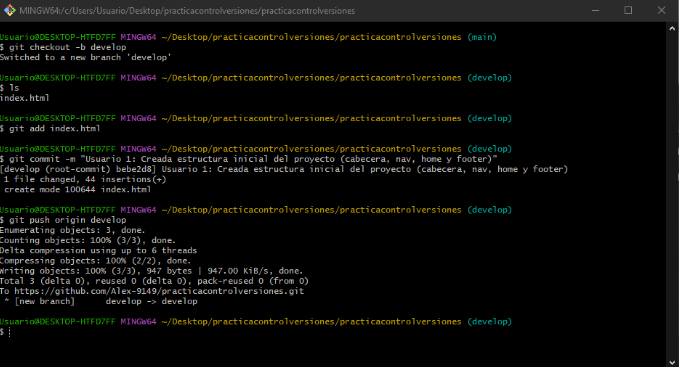
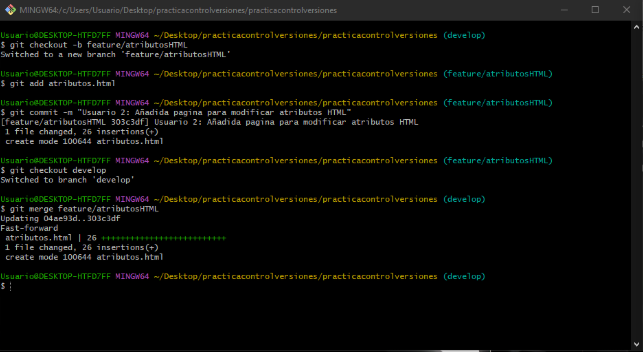
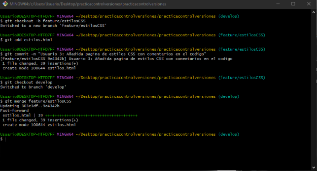
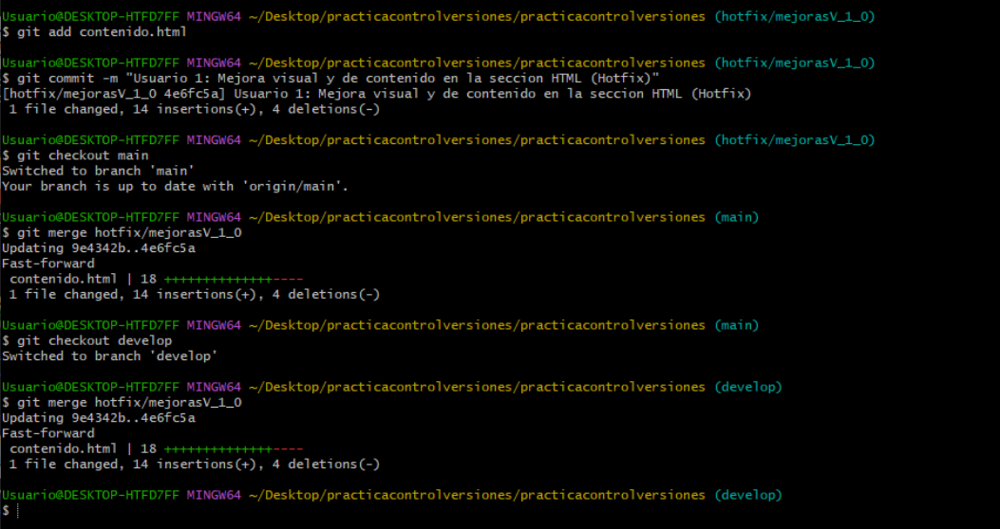

# Memoria del Proyecto: Curso de JavaScript con Git Flow

## 1. Introducción Teórica
**Git** es un sistema de control de versiones distribuido que permite registrar los cambios en los archivos de un proyecto a lo largo del tiempo, facilitando el trabajo colaborativo, la reversión a estados anteriores y la gestión de diferentes líneas de desarrollo de forma segura.

**Git Flow** es una metodología y modelo de ramificación para Git que define una estructura estricta alrededor de las *releases* del proyecto. Utiliza dos ramas principales con una vida infinita (`main` para producción y `develop` para integración) y ramas de apoyo temporales (`feature`, `release`, `hotfix`). 

Utilizamos Git Flow en este desarrollo porque proporciona un marco de trabajo robusto para equipos, permitiendo desarrollar nuevas funcionalidades (features) de forma aislada sin romper el código base, preparar versiones estables (releases) y solucionar errores críticos en producción rápidamente (hotfixes) sin interferir en el desarrollo en curso.

## 2. Explicación Detallada del Proceso

### Usuario 1: Estructura inicial y configuración
El Usuario 1 inicializó el repositorio y creó las ramas principales `main` y `develop`. Posteriormente, implementó la estructura base del proyecto (`index.html` con cabecera, navegación y footer).
*Captura de pantalla de la creación de las ramas y el primer commit:*

### Usuario 2: Creación de Features de HTML
El Usuario 2 creó dos ramas independientes desde `develop`:
1. `feature/contenidoHTML`: Se añadió la sección para modificar el contenido.
2. `feature/atributosHTML`: Se añadió el ejemplo para modificar atributos.
Ambas ramas fueron fusionadas de vuelta a `develop`.
*Captura de pantalla de los commits y fusión del Usuario 2:*

### Usuario 3: Estilos CSS y Release v1.0
El Usuario 3 desarrolló la `feature/estilosCSS`. Tras fusionarla en `develop`, generó la rama `release/v1.0` para empaquetar la primera versión del curso. Esta versión se fusionó en `main` y `develop`, y se etiquetó como `v1.0`.
*Captura de pantalla de la etiqueta v1.0 y el log de Git:*

### Usuario 1: Hotfix de Mejora
Para mejorar visualmente la sección de contenido en producción, el Usuario 1 creó la rama `hotfix/mejorasV_1_0` directamente desde `main`. Tras aplicar los estilos al botón, se fusionó en `main` (etiquetado como parche) y en `develop`.
*Captura de pantalla del grafo de ramas (Git Graph) o log final:*

